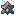

<div align="center">
  
  <h1>Summer Fantasy Web</h1>
  <p>
    <strong>Sitio web estático del servidor de Minecraft Summer Fantasy.</strong><br>
    Supervivencia extrema con tecnología, magia, jefes épicos y combate PvE/PvP.<br>
    Diseño inmersivo oscuro/dungeon con Astro, Tailwind CSS y React.
  </p>

  <p>
    <a href="https://fantasy.rezzt.dev"></a>
    <a href="https://astro.build"></a>
    <a href="https://tailwindcss.com"></a>
    <a href="https://react.dev"></a>
    <a href="https://vitejs.dev"></a>
    <a href="https://www.typescriptlang.org"></a>
  </p>
</div>

---

## Tabla de contenidos

- [Sobre el proyecto](#sobre-el-proyecto)
- [Información del servidor](#información-del-servidor)
- [Características principales](#características-principales)
- [Tecnologías](#tecnologías)
- [Requisitos](#requisitos)
- [Instalación y uso](#instalación-y-uso)
- [Estructura del proyecto](#estructura-del-proyecto)
- [Rutas](#rutas)
- [Contenido](#contenido)
- [Recursos gráficos](#recursos-gráficos)
- [Créditos y contacto](#créditos-y-contacto)

---

## Sobre el proyecto

Summer Fantasy Web es la web oficial del servidor de Minecraft **Summer Fantasy**. El sitio está pensado para presentar la información del servidor, guiar a los nuevos jugadores, resolver dudas frecuentes y documentar los mods propios e instalados.

El proyecto se genera como un sitio estático con **Astro 7**, lo que garantiza un rendimiento alto y tiempos de carga reducidos. Las wikis interactivas de los mods utilizan **React 19** junto con **Framer Motion** y **anime.js** para ofrecer transiciones y animaciones fluidas.

El diseño visual sigue una estética **inmersiva oscura/dungeon** inspirada en las wikis de mods de Minecraft: paleta de negros, rojos, piedra y papiro, paneles con bordes gruesos, tipografía `Russo One` / `Cinzel` y partículas de fuego.

---

## Información del servidor

| Campo | Valor |
|-------|-------|
| Versión | Minecraft 1.20.1 |
| Loader | Forge |
| Dificultad | Progresiva con Scaling Difficult |
| Mods | 261+ |
| Slots | 10 |
| Región | Europa (Francia) |
| Whitelist | Sí |
| Cuenta premium | Sí |

Para solicitar acceso, contacta con el staff a través del Discord privado del servidor.

---

## Características principales

- **Página de inicio**: hero inmersivo, estadísticas del servidor, pasos para entrar, reglas principales, primeros pasos y soporte.
- **Índice de wikis**: listado organizado por categorías de todos los artículos de documentación.
- **Wikis de mods interactivas**: páginas dedicadas a Scaling Difficult, Eazzy Server Utils, Safety ZStones y Server + Primeros Pasos, construidas con React y componentes específicos.
- **FAQ**: preguntas frecuentes con acordeones y búsqueda, sobre la versión, instalación, modpack, premium, PvP, griefing, reportes, economía y más.
- **Artículos dinámicos**: rutas generadas automáticamente desde colecciones Markdown de Astro (`/wiki/[slug]`).
- **Diseño responsive**: el sitio se adapta a dispositivos móviles y escritorio.
- **Animaciones**: transiciones de entrada, partículas de fuego y efectos visuales con `anime.js` y `framer-motion`.

---

## Tecnologías

| Tecnología | Uso |
|------------|-----|
| [Astro 7](https://astro.build) | Framework web para generación de sitios estáticos. |
| [Tailwind CSS 4](https://tailwindcss.com) | Utilidades CSS para el diseño visual. |
| [React 19](https://react.dev) | Componentes interactivos de las wikis de mods. |
| [Vite](https://vitejs.dev) | Bundler y dev server. |
| [TypeScript](https://www.typescriptlang.org) | Tipado estático. |
| [Framer Motion](https://www.framer.com/motion/) | Animaciones declarativas en React. |
| [anime.js](https://animejs.com) | Animaciones secuenciales y partículas. |
| [lucide-react](https://lucide.dev) | Iconografía del sitio. |

---

## Requisitos

- [Node.js](https://nodejs.org) >= 22.12.0
- [npm](https://www.npmjs.com) u otro gestor de paquetes compatible

---

## Instalación y uso

1. Clona el repositorio:

   ```bash
   git clone https://github.com/rezzt-dev/summer-fantasy-web.git
   cd summer-fantasy-web/summer-fantasy
   ```

2. Instala las dependencias:

   ```bash
   npm install
   ```

3. Inicia el servidor de desarrollo:

   ```bash
   npm run dev
   ```

   El sitio estará disponible en [http://localhost:4321](http://localhost:4321).

4. Genera el build de producción:

   ```bash
   npm run build
   ```

   El resultado se guarda en `summer-fantasy/dist/`.

5. Previsualiza el build:

   ```bash
   npm run preview
   ```

### Comandos principales

| Comando | Descripción |
|---------|-------------|
| `npm run dev` | Servidor de desarrollo en `http://localhost:4321` |
| `npm run build` | Generación estática en `dist/` |
| `npm run preview` | Previsualización del build |
| `npm run astro` | CLI de Astro |

---

## Estructura del proyecto

```
summer-fantasy-web/
├── summer-fantasy/          # Proyecto Astro
│   ├── src/
│   │   ├── pages/           # Rutas del sitio
│   │   ├── layouts/         # Layouts base
│   │   ├── components/      # Componentes reutilizables
│   │   │   ├── site/        # Componentes del sitio público
│   │   │   ├── wiki/        # Componentes base de wikis
│   │   │   ├── scaling-difficult/   # Wiki de Scaling Difficult
│   │   │   ├── eazzy-server-utils/  # Wiki de Eazzy Server Utils
│   │   │   ├── safety-zstones/      # Wiki de Safety ZStones
│   │   │   ├── server/              # Wiki de Server + Primeros Pasos
│   │   │   └── wiki-index/          # Índice de wikis
│   │   ├── content/         # Colecciones de contenido Markdown
│   │   │   ├── wiki/        # Artículos de wiki
│   │   │   ├── faq/         # Preguntas frecuentes
│   │   │   └── server/      # Información del servidor
│   │   ├── styles/          # Hojas de estilo globales
│   │   └── content.config.ts        # Esquemas de colecciones
│   ├── public/              # Recursos estáticos
│   ├── astro.config.mjs     # Configuración de Astro
│   ├── package.json         # Dependencias y scripts
│   └── dist/                # Build de producción (generado)
├── agent-docs/              # Documentación fuente para agentes (solo lectura)
├── AGENTS.md                # Guía para agentes
├── .gitignore               # Archivos ignorados por Git
└── README.md                # Este archivo
```

---

## Rutas

| Ruta | Descripción |
|------|-------------|
| `/` | Página de inicio |
| `/wiki` | Índice de wikis |
| `/wiki/scaling-difficult` | Wiki del mod Scaling Difficult |
| `/wiki/eazzy-server-utils` | Wiki del mod Eazzy Server Utils |
| `/wiki/safety-zstones` | Wiki del mod Safety ZStones |
| `/wiki/server` | Información del servidor y primeros pasos |
| `/wiki/[slug]` | Artículos de wiki generados desde Markdown |
| `/faq` | Preguntas frecuentes |
| `/404` | Página de error 404 |

---

## Contenido

El contenido se escribe en **Markdown** dentro de las colecciones de `summer-fantasy/src/content/`:

- `wiki/`: artículos de documentación con `title`, `description`, `category` y `order`.
- `faq/`: preguntas y respuestas con `question` y `order`.
- `server/`: ficha técnica del servidor con `version`, `loader`, `difficulty`, `modCount`, `slots`, `region`, `whitelist` y `premium`.

El campo `order` controla el orden de visualización de los artículos y preguntas.

---

## Recursos gráficos

El proyecto incluye texturas e ítems del mod Scaling Difficult bajo `summer-fantasy/public/scaling-difficult/`. Algunos ejemplos:

| Ítem | Vista previa |
|------|-------------|
| Corona del caos |  |
| Arco de la viuda |  |
| Fragmento de comando |  |
| Estrella del Nether comprimida |  |

---

## Créditos y contacto

- **Proyecto**: Summer Fantasy Web
- **Servidor**: Summer Fantasy (Minecraft 1.20.1, Forge)
- **Staff**: `rezztdev`
- **Comunidad**: Discord privado para jugadores del servidor
- **Repositorio**: [github.com/rezzt-dev/summer-fantasy-web](https://github.com/rezzt-dev/summer-fantasy-web)

Si encuentras algún error o quieres proponer una mejora, abre un issue en el repositorio o contacta con el staff a través del Discord del servidor.

---

<div align="center">
  <p><strong>Sitio web:</strong> <a href="https://fantasy.rezzt.dev">fantasy.rezzt.dev</a></p>
  <p>Documentación y guías del servidor de Minecraft Summer Fantasy.</p>
</div>
